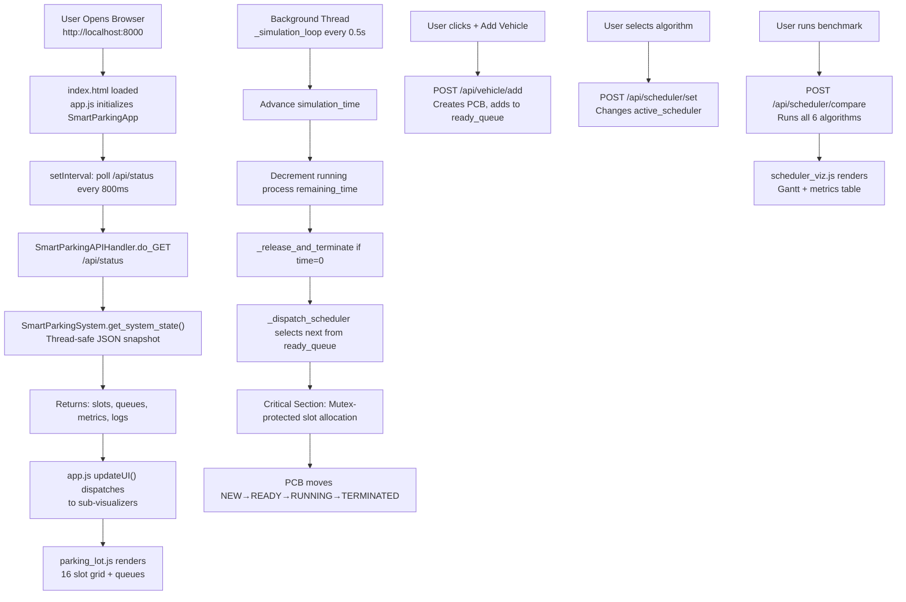

# 🅿️ Smart Parking Management System — Full Project Report

**Course:** Operating Systems (CCSE0303A) — Unit 2 & Unit 3  
**Institution:** NIET Greater Noida · CSE-AI Department  
**Group:** Group 7 — Ishank Rana, Chhavi Attri, Aditi Singh, Pratyush Agrahari, Samar Singh  
**Faculty:** Mr. Amar Pal Yadav & Dr. Varsha Jotwani  
**SDG Impact:** SDG 11 — Sustainable Cities & Communities

---

## 📌 Overview

This project is a **real-time, interactive web-based simulation** of a Smart Parking Management System that uses it as a live, relatable analogy to demonstrate and visualize **core Operating System concepts** from Unit 2 (Process Management & CPU Scheduling) and Unit 3 (Concurrency, Synchronization & Deadlock).

Instead of abstract OS theory, every concept maps to the real world:
- A **vehicle** = an OS **Process**
- A **parking slot** = a **shared hardware resource**
- A **gate barrier** = the **critical section** boundary
- **Scheduling a vehicle into a bay** = **CPU dispatch / slot allocation**

The system runs a Python HTTP server backend and serves a modern single-page web dashboard. Everything is live and interactive — you can add vehicles, switch scheduling algorithms, test deadlock scenarios, and simulate concurrency problems all from the browser.

---

## 🏗️ Project Architecture

```
OS/
├── main.py                    ← Python HTTP Server + REST API (all endpoints)
├── run_system.bat             ← One-click launcher (Windows)
├── backend/
│   ├── models.py              ← Core data models: PCB, ParkingSlot, Enums
│   ├── parking_system.py      ← Main simulation engine (threading, queues, events)
│   ├── scheduler.py           ← 6 CPU scheduling algorithm implementations
│   ├── bankers.py             ← Banker's Algorithm + RAG deadlock detection
│   ├── concurrency.py         ← Race condition, Peterson, TSL, Semaphore simulators
│   ├── classical.py           ← Classical sync problems (PC, RW, SB, DP)
│   └── __init__.py
└── static/
    ├── index.html             ← Full single-page web dashboard (6 operational modules)
    ├── css/style.css          ← Precision automotive telemetry UI (design-system standard)
    └── js/
        ├── libs/
        │   ├── three.min.js   ← Three.js WebGL 3D rendering engine (offline standalone)
        │   └── OrbitControls.js ← 3D camera orbit, pan, and zoom controls
        ├── three_parking.js   ← Tab 1: 3D interactive parking digital twin & raycaster
        ├── app.js             ← Core controller: polling, audio synthesis, simulation controls
        ├── parking_lot.js     ← Tab 1: 2D architectural schematic + PCB inspector drawer
        ├── scheduler_viz.js   ← Tab 2: Gantt chart + 6-algorithm benchmark arena
        ├── concurrency_viz.js ← Tab 3: Race condition, Peterson, TSL, & semaphore UI
        ├── bankers_viz.js     ← Tab 4: Banker's matrix + RAG cycle visualizer
        └── classical_viz.js   ← Tab 5: Classical sync problems (PC, RW, Barber, Dining)
```

---

## ⚙️ Backend — How It Works

### `main.py` — The HTTP Server

- Built using Python's built-in `http.server.HTTPServer` and `SimpleHTTPRequestHandler` — **no external frameworks needed**.
- Serves both the static frontend files AND REST API endpoints over port `8000` (auto-increments if busy).
- On startup it:
  1. Initializes the `SmartParkingSystem` core engine.
  2. Injects the system into the HTTP handler class.
  3. Launches the browser automatically after 1 second using `webbrowser.open()`.
  4. Starts `httpd.serve_forever()`.

**API Endpoints handled:**

| Method | Endpoint | What It Does |
|--------|----------|--------------|
| GET | `/api/status` | Polls complete system state (slots, queues, metrics, logs) |
| POST | `/api/vehicle/add` | Adds a new vehicle/process to the ready queue |
| POST | `/api/slot/release` | Manually releases a parking slot (terminates process) |
| POST | `/api/scheduler/set` | Changes the active scheduling algorithm + time quantum |
| POST | `/api/scheduler/compare` | Runs all 6 algorithms and returns comparative data |
| GET | `/api/concurrency/peterson` | Returns Peterson's Algorithm trace steps |
| GET | `/api/concurrency/tsl` | Returns Test-and-Set Lock trace steps |
| POST | `/api/concurrency/race` | Simulates race condition (unsync or mutex mode) |
| POST | `/api/concurrency/semaphore` | Performs WAIT/SIGNAL on counting semaphore |
| GET | `/api/bankers/safety` | Runs Banker's Safety Algorithm |
| POST | `/api/bankers/request` | Simulates a resource request through Banker's Algorithm |
| POST | `/api/bankers/rag` | Builds RAG from provided nodes/edges and detects cycles |
| GET | `/api/classical/state` | Returns all 4 classical problem states |
| POST | `/api/classical/action` | Triggers actions on Producer-Consumer, Reader-Writer, Sleeping Barber, or Dining Philosophers |
| POST | `/api/simulation/control` | Pause / Resume / Speed / Reset the simulation |

---

### `backend/models.py` — Core Data Models

This file defines the fundamental OS abstractions as Python classes:

#### `ProcessState` (Enum)
Maps to OS process lifecycle:
```
NEW → READY → RUNNING → WAITING → TERMINATED
```
- **NEW** — Vehicle request created at entry gate
- **READY** — Validated, waiting in scheduler queue
- **RUNNING** — Allocated a parking slot (in critical section)
- **WAITING** — Blocked because all slots are occupied
- **TERMINATED** — Vehicle departed, slot freed, bill settled

#### `VehicleType` (Enum) — Maps to Process Priority
| Vehicle Type | OS Priority | Real-World Mapping |
|---|---|---|
| EMERGENCY | 1 (Highest) | Ambulance, Police, Fire brigade |
| EV | 2 | Electric vehicle (needs charging bay) |
| SUV | 3 | Heavy/large vehicle |
| STANDARD | 4 (Lowest) | Sedan, hatchback, compact |

#### `ParkingSlotType` (Enum) — Maps to Resource Types
| Slot Type | Count | Slots |
|---|---|---|
| COMPACT | 8 | S01–S08 |
| EV_CHARGING | 4 | S09–S12 |
| SUV_HEAVY | 2 | S13–S14 |
| VALET | 2 | S15–S16 |

#### `ProcessControlBlock` (Class)
The **PCB** is the most important OS structure — it represents everything the OS knows about a process (vehicle). Fields include:
- `pid`, `plate`, `vehicle_type`, `priority`
- `arrival_time`, `burst_time`, `remaining_time`
- `state` — current lifecycle state
- `slot_id` — which bay is allocated
- `start_time`, `completion_time`, `waiting_time`, `turnaround_time`
- `context_switches` — how many times preempted
- `memory_footprint` — simulated KB
- `registers` — simulated CPU register snapshot (PC, SP, ACC, STATUS)

#### `ParkingSlot` (Class)
Represents a shared hardware resource:
- Has `allocate(pcb)` and `release()` methods
- Tracks `status` (FREE / OCCUPIED / RESERVED / IN_CRITICAL_SECTION)
- Tracks `total_vehicles_served` for analytics

---

### `backend/parking_system.py` — The Core OS Engine

This is the brain of the simulation. `SmartParkingSystem` runs continuously in a background thread and acts as a multi-level scheduler.

#### Key OS Structures Maintained:
```python
self.job_pool          # Long-Term Scheduler pool
self.ready_queue       # Short-Term Scheduler queue (sorted by active algorithm)
self.waiting_queue     # Mid-Term Scheduler / Blocked queue
self.running_processes # Currently active (parked) processes
self.terminated_processes  # Completed (departed) process history
```

#### Synchronization Primitives:
```python
self.lock                     # RLock for thread-safe access to all data
self.critical_section_lock    # Mutex for slot allocation atomic operation
self.available_slots_semaphore # Counting semaphore (capacity = 16)
```

#### The Simulation Loop (`_simulation_loop`)
Runs every **0.5 seconds** in a daemon thread:
1. Advances `simulation_time` by `0.5 × speed_multiplier`
2. Decrements `remaining_time` for all running processes
3. Terminates any processes whose remaining time reaches 0
4. Calls the short-term scheduler to dispatch ready queue

#### The Short-Term Scheduler (`_dispatch_scheduler`)
- Sorts the `ready_queue` based on the active algorithm (FCFS, SJF, SRTF, Priority, RR)
- Picks the top candidate from the queue
- Finds a suitable slot using `_find_suitable_slot()` (type-matched first, then any free slot as fallback)
- **Enters the Critical Section** using `with self.critical_section_lock:`
- Inside the critical section: does a double-check and atomically allocates the slot to the process
- Logs the event and moves the process to `running_processes`

#### Slot Type Matching Logic:
```
EMERGENCY vehicle → prefers VALET slot
EV vehicle        → prefers EV_CHARGING slot
SUV vehicle       → prefers SUV_HEAVY slot
STANDARD vehicle  → prefers COMPACT slot
All types         → fallback to any free slot if preferred unavailable
```

#### `_release_and_terminate(pid)`:
- Releases the slot
- Computes final metrics: `completion_time`, `turnaround_time`, `waiting_time`
- Moves PCB to `terminated_processes`
- Logs the departure event

---

### `backend/scheduler.py` — 6 CPU Scheduling Algorithms

The `SchedulingEngine` class implements all 6 standard OS scheduling algorithms in pure Python. Each algorithm takes a list of process dictionaries and returns a structured result with a `timeline`, per-process `metrics`, and aggregate statistics.

#### 1. **FCFS — First-Come, First-Served** (Non-Preemptive)
- Sorts by arrival time.
- Processes run to completion in order of arrival.
- No preemption. Simple but may cause convoy effect.
- Vehicle analogy: First car to arrive at gate gets parked first.

#### 2. **SJF — Shortest Job First** (Non-Preemptive)
- Among all arrived processes, picks the one with the shortest burst time.
- Cannot preempt a running process.
- Vehicle analogy: Among waiting cars, the one needing shortest parking time is served first.

#### 3. **SRTF — Shortest Remaining Time First** (Preemptive)
- At every time step (0.5s resolution), picks process with smallest remaining burst.
- Can preempt a currently running process if a shorter one arrives.
- Vehicle analogy: If a car with shorter remaining time arrives, current car may be bumped.

#### 4. **Priority Non-Preemptive**
- Sorts by priority value (1 = highest). Once running, cannot be preempted.
- Vehicle analogy: Emergency vehicles are prioritized but can't displace an already-parked car.

#### 5. **Priority Preemptive**
- Same priority ordering but can preempt a currently running process.
- Vehicle analogy: An ambulance arriving can immediately displace a lower-priority car.
- **This is the default algorithm running in the live simulation.**

#### 6. **Round Robin** (with configurable time quantum)
- Each process gets a fixed time slice (quantum). After the slice expires, it goes back to the queue.
- User can set the quantum from 1–10 seconds via the slider.
- Vehicle analogy: Each car gets a timed parking session; if not done, it cycles back to the queue.

**Metrics computed for every algorithm:**
- Average Waiting Time (AWT)
- Average Turnaround Time (ATAT)
- Average Response Time
- CPU Utilization %
- System Throughput (processes/unit time)

---

### `backend/bankers.py` — Deadlock Avoidance

Implements the complete **Banker's Algorithm** with 5 processes and 4 resource types:

| Resource | Meaning |
|---|---|
| R0 — Compact Slot | Standard parking bays |
| R1 — EV Charging | Electric vehicle charging bays |
| R2 — SUV Bay | Heavy vehicle bays |
| R3 — Valet Transfer | Emergency/VIP bays |

**5 Processes:** P0 (Fleet Van), P1 (EV Taxi), P2 (Heavy Truck), P3 (Compact EV), P4 (Family SUV)

#### 1. Safety Algorithm (`run_safety_algorithm`)
- Computes `Need = Max − Allocation` matrix
- Simulates the "banker's" greedy approach: tries to find a safe sequence where all processes can complete
- Returns: `is_safe`, `safe_sequence`, step-by-step `trace_steps`, and all matrices
- If no safe sequence exists → system is in **unsafe state** (deadlock risk)

#### 2. Resource Request Algorithm (`request_resources`)
Four-step process:
1. Check `Request ≤ Need` (process isn't exceeding its declared maximum)
2. Check `Request ≤ Available` (resources exist)
3. **Tentatively allocate** the resources
4. Run safety check on tentative state — if safe, commit; if unsafe, **revert and deny**

#### 3. RAG / WFG Deadlock Detection (`detect_rag_deadlock`)
- Builds a **Resource Allocation Graph** from provided nodes and edges
- Runs **DFS-based cycle detection**
- If a cycle is found → **deadlock detected**
- Reports all 4 Coffman Conditions:
  - Mutual Exclusion
  - Hold and Wait
  - No Preemption
  - Circular Wait (present/absent)

---

### `backend/concurrency.py` — Critical Section & Synchronization

#### 1. Race Condition Simulator (`simulate_race_condition`)
Shows step-by-step what happens when two threads try to allocate the **same slot simultaneously without a lock**:
- Thread A reads slot as FREE
- Thread B also reads slot as FREE (before A writes!)
- Thread A writes "allocated to A"
- Thread B **overwrites** → "CORRUPTED / DOUBLE_BOOKED"
- Result: Both vehicles think they have the same slot → **race condition**

#### 2. Mutex-Synchronized Simulation (`simulate_synchronized_allocation`)
Shows the correct behavior with a **Mutex lock**:
- Thread A acquires mutex → enters critical section → allocates slot
- Thread B tries to acquire mutex → **blocked** (cannot enter)
- Thread A releases mutex → Thread B wakes up
- Thread B enters, checks slot → already OCCUPIED → redirects to next free slot
- Result: **Safe allocation, no collision**

#### 3. Peterson's Algorithm (`trace_petersons_algorithm`)
7-step trace of Peterson's Software Mutual Exclusion for 2 processes (P0 = North Gate, P1 = South Gate):
- Uses `flag[0]`, `flag[1]`, and shared `turn` variable
- **Proves** Mutual Exclusion, Progress, and Bounded Waiting
- Simulates both gates competing for the slot allocation critical section

#### 4. Test-and-Set Lock (`trace_test_and_set`)
4-step hardware-level atomic instruction trace:
- P0 calls `TestAndSet(&lock)` → gets 0 (FREE), atomically sets to 1 → enters critical section
- P1 calls `TestAndSet(&lock)` → gets 1 (LOCKED) → **spinlocks** (busy waiting)
- P0 resets lock to 0 in exit section
- P1's next `TestAndSet` gets 0 → enters safely

#### 5. Counting Semaphore (`counting_semaphore_action`)
- Semaphore value = number of free parking slots (starts at 16)
- `WAIT` (P operation): Decrements value. If negative → process is blocked and queued
- `SIGNAL` (V operation): Increments value. If blocked processes exist → unblock first in queue

---

### `backend/classical.py` — Classical Synchronization Problems

#### 1. Producer-Consumer (Bounded Buffer)
- **Buffer** = Waiting bay queue (capacity 5)
- **Producer** = Entry camera (creates vehicle records)
- **Consumer** = Slot allocator (dispatches vehicles to bays)
- If buffer full → Producer BLOCKS (waits on `empty` semaphore)
- If buffer empty → Consumer BLOCKS (waits on `full` semaphore)

#### 2. Reader-Writer Problem
- **Readers** = Digital availability signboards / mobile apps (can read concurrently)
- **Writer** = Gate entry system (needs exclusive access to update slot count)
- Multiple readers can read simultaneously if no writer is active
- Writer needs exclusive lock (`wrt` semaphore) — no readers and no other writers allowed
- Writer BLOCKED if any reader is active

#### 3. Sleeping Barber (Smart Gatekeeper)
- **Barber** = Smart barrier gatekeeper
- **Waiting chairs** = Entry bay (capacity 4)
- If no cars → Gatekeeper falls asleep
- First car arrives → Rings buzzer, wakes gatekeeper → begins entry processing
- If busy, subsequent cars take waiting chairs
- If all 4 chairs occupied → Car **balks** (drives away)

#### 4. Dining Philosophers (Roundabout Deadlock)
- **5 vehicles** at a 5-way roundabout intersection
- **5 road segments** = shared resources (like forks)
- **Deadlock scenario:** All 5 cars grab their left segment simultaneously → **circular wait** → no one can proceed
- **Resolution:** Asymmetric resource ordering (Dijkstra's solution) — Car 4 picks right segment first, breaking the circular dependency

---

## 🖥️ Frontend — The Web Dashboard

### `static/index.html` — Single Page Application

A full responsive single-page dashboard with **6 tabs**, served directly by the Python server. Uses Google Fonts (Inter + Fira Code), custom CSS variables for theming, and vanilla JavaScript.

**Global Header** shows live system stats:
- Simulation time counter
- Slot utilization %
- Active scheduling algorithm
- Ready queue count
- Speed selector (0.5x / 1x / 2x / 5x)
- Play/Pause toggle
- "+ Add Vehicle" button (opens modal)
- "⚡ Burst" button (adds 4 vehicles at once: Emergency, EV, SUV, Standard)
- Sound toggle & Reset button

---

### Tab 1: 🅿️ Parking Yard & PCB

**Left panel — Parking Lot Grid:**
- Shows all 16 slots dynamically rendered:
  - 🟩 Green = FREE slot
  - 🔴 Red = OCCUPIED (shows PID + plate + vehicle type)
  - Sections labeled: A (Compact S01-S08), B (EV S09-S12), C (SUV S13-S14), D (Valet S15-S16)
- Clicking an occupied slot allows manual release
- Gate simulation bar at the top shows barrier servo animation and scheduler status

**Right panel — Process Queue Inspector:**
1. **Critical Section Monitor** — Shows if the slot allocation mutex is locked/unlocked + which PID holds it
2. **Ready Queue** — Lists all vehicles waiting to be dispatched (PCB cards with priority, burst time)
3. **Blocked/Waiting Queue** — Vehicles waiting because no suitable slot is available
4. **Terminated Tasks** — Last 10 departed vehicles with TAT and WT metrics

**Event Stream (bottom):** Real-time OS kernel event log — shows PROCESS_CREATE, SLOT_ALLOCATE, RESOURCE_WAIT, PROCESS_TERMINATE events with timestamps.

---

### Tab 2: ⏱️ CPU Scheduling & Gantt Chart

**Algorithm Selector Pills:** FCFS | SJF (Non-Preemptive) | SRTF (Preemptive) | Priority (NP) | Priority (P) | Round Robin

**Round Robin Quantum Slider:** 1–10 seconds, real-time label update.

**"Run 6-Algorithm Benchmark" Button:** Runs all 6 algorithms on the current vehicle set simultaneously and shows comparison cards.

**Gantt Chart Viewport:**
- Visual timeline showing each process's execution blocks
- Color-coded by PID
- IDLE gaps shown in grey
- Time labels on X axis

**Per-Process Metrics Table:**
| Column | Formula |
|---|---|
| Completion Time | When process finishes |
| Turnaround Time | CT − Arrival Time |
| Waiting Time | TAT − Burst Time |
| Response Time | First Start − Arrival Time |

**6-Algorithm Comparison Cards:** Side-by-side bar-style cards showing AWT, ATAT, CPU%, Throughput for all algorithms simultaneously.

When you select an algorithm pill, it also sets that as the **live system's active scheduler** via API, affecting real-time slot allocation.

---

### Tab 3: 🔒 Concurrency & Critical Section Lab

**Race Condition Arena:**
- Two buttons: "💥 Unsynchronized" and "🔒 Mutex Synchronized"
- "▶ Execute Concurrency Test" runs the chosen mode
- Displays step-by-step trace cards showing thread actions, slot state, and collision/protection result

**Peterson's Algorithm Visualizer:**
- "Run Peterson's Trace" button
- Shows 7 animated steps with flag values, turn variable, and which process is in the critical section

**Test-and-Set Lock Trace:**
- "Trace TSL Hardware Lock" button
- Shows 4 steps with hardware lock state, process name, instruction, and result

**Counting Semaphore Interactive Panel:**
- Shows current semaphore value (0–16)
- "WAIT (P)" and "SIGNAL (V)" buttons
- Input field for process ID
- Visual blocked queue list
- Color-coded value indicator (green = available, red = blocked)

---

### Tab 4: 🏦 Banker's Algorithm & Deadlock

**Matrix Display:**
- Available vector [R0, R1, R2, R3]
- Allocation matrix (5 processes × 4 resources)
- Maximum matrix
- Need matrix (computed: Max − Allocation)
- All labeled with resource names and process names

**"Run Safety Algorithm" Button:**
- Calls `/api/bankers/safety`
- Shows step-by-step trace (each round of the algorithm)
- Displays safe sequence result: e.g., `P1 → P3 → P4 → P0 → P2`
- Color-coded SAFE (green) / UNSAFE (red) result

**Resource Request Simulator:**
- Process index selector (P0–P4)
- Input for request vector [R0, R1, R2, R3]
- Shows 4-step validation trace (request ≤ need, request ≤ available, tentative alloc, safety check)
- GRANTED or DENIED result with reason

**RAG / Deadlock Detector:**
- Input nodes and edges for custom Resource Allocation Graph
- DFS cycle detection
- Shows detected cycles, deadlock status, and Coffman Conditions checklist
- Recovery recommendation

---

### Tab 5: 🔄 Classical Sync Problems

**Producer-Consumer Panel:**
- Visual buffer bar showing occupancy (e.g., 3/5)
- "Produce (Entry Camera)" and "Consume (Allocate to Slot)" buttons
- Status messages showing semaphore events (BUFFER_FULL, PRODUCED, CONSUMED, BUFFER_EMPTY)
- History log of last 5 operations

**Reader-Writer Panel:**
- Shows active readers list and active writer
- "Start Read", "Stop Read" (with reader ID input)
- "Start Write", "Stop Write" (with writer ID and slot count input)
- BLOCKED/SUCCESS status with lock state explanation

**Sleeping Barber Panel:**
- Gatekeeper status indicator (SLEEPING / SERVICING)
- Waiting chairs visualization (filled/empty chairs)
- "Car Arrives" and "Finish Service" buttons
- State transitions with messages (WOKE_GATEKEEPER, WAITING_IN_CHAIR, BALKED_LEFT, FALL_ASLEEP)

**Dining Philosophers (Roundabout) Panel:**
- 5-way roundabout diagram
- Each "philosopher" (vehicle) state: THINKING / HUNGRY / EATING
- "Trigger Deadlock" button — locks all 5 in circular wait
- "Apply Fix (Resource Ordering)" button — resolves via asymmetric ordering
- Coffman conditions checklist shown for deadlock state

---

### Tab 6: 📘 Academic Report & Syllabus

- Progress report content embedded inline
- Unit 2 and Unit 3 syllabus mapping table
- OS concept → Parking analogy cross-reference
- Group member contributions

---

## 🎨 Frontend JavaScript Modules

### `app.js` — Core Controller
- `SmartParkingApp` class manages everything:
  - **Polling:** Calls `/api/status` every **800ms** to get live system state and update the UI
  - **Tab switching:** Activates correct panel + triggers sub-module refresh
  - **Modal handling:** Add vehicle form with validation
  - **Web Audio API:** Procedural sound effects (click, lock, success, alarm tones via oscillators)
  - **Toast notifications:** Auto-dismissing status messages (4.5 second timeout)
  - **Traffic Burst:** Adds Emergency + EV + SUV + Standard vehicle in rapid sequence
  - **Fallback mode:** If server is unreachable (file:// mode), shows "STANDALONE DEMO" gracefully

### `parking_lot.js` — Parking Grid Renderer
- Renders all 16 slot cards dynamically from state data
- Color-codes slots by status and type
- Renders Ready, Waiting, Running, Terminated queue lists as PCB cards
- Updates Critical Section indicator
- Streams event logs to the kernel event stream panel

### `scheduler_viz.js` — Gantt + Scheduler UI
- Handles algorithm pill click → calls `/api/scheduler/set`
- Renders Gantt chart from timeline data returned by backend
- Calculates bar widths proportional to time
- Renders per-process metrics table rows
- Renders 6-algorithm benchmark comparison cards

### `bankers_viz.js` — Banker's Matrix Visualizer
- Renders allocation, max, and need matrices as HTML tables
- Animates step-by-step safety trace
- Handles resource request form → calls `/api/bankers/request`
- Renders RAG cycle detection results

### `concurrency_viz.js` — Concurrency Lab UI
- Race condition trace step renderer (unsync vs mutex comparison)
- Peterson's algorithm step-by-step visualizer with flag/turn state table
- TSL hardware trace renderer
- Semaphore interactive panel with blocked queue display

### `classical_viz.js` — Classical Problems UI
- Syncs all 4 classical problem panels from `/api/classical/state`
- Handles all 4 sets of interactive buttons
- Producer-Consumer buffer visualization
- Sleeping barber state/chair visualization
- Dining philosophers roundabout state diagram

---

## 🔄 How Everything Flows Together



---

## 📊 OS Concepts → Parking Analogy Mapping Table

| OS Concept | Parking System Equivalent |
|---|---|
| Process | Vehicle (parking request) |
| PCB (Process Control Block) | Vehicle's parking ticket & system record |
| Process State (NEW/READY/RUNNING/WAITING/TERMINATED) | Vehicle lifecycle at the parking lot |
| Long-Term Scheduler | Main entry gate admissions control |
| Short-Term Scheduler (CPU Dispatcher) | Slot assignment officer (selects from ready queue) |
| Ready Queue | Validated vehicles waiting for bay assignment |
| Blocked/Waiting Queue | Vehicles waiting because all bays are full |
| Critical Section | Slot allocation code block (only one at a time) |
| Mutex Lock | Barrier gate lock (prevents simultaneous double-booking) |
| Counting Semaphore | Counter of available parking spaces |
| FCFS Scheduling | First car to queue gets first bay |
| SJF Scheduling | Shortest-stay car parked first |
| SRTF Scheduling | Preemptive: shortest remaining stay wins even mid-session |
| Priority Scheduling | Emergency vehicles always get priority bays |
| Round Robin | Each car gets a fixed-duration parking window |
| Race Condition | Two gates simultaneously assigning the same slot |
| Peterson's Solution | Two gates' software handshake protocol |
| Test-and-Set Lock | Hardware-level atomic gate lock instruction |
| Banker's Algorithm | Parking authority checks safe resource allocation before granting |
| Deadlock | All 5 roundabout cars blocking each other simultaneously |
| Resource Allocation Graph | Network diagram showing which car holds which bay and is waiting for what |
| Circular Wait | Roundabout deadlock (Car A waits for B, B waits for C, ... E waits for A) |
| Coffman Conditions | The 4 necessary conditions for roundabout gridlock |
| Producer-Consumer | Entry camera (producer) → waiting buffer → slot allocator (consumer) |
| Reader-Writer | Signboard/app (readers) vs gate system updating slot count (writer) |
| Sleeping Barber | Smart gatekeeper sleeping until first car arrives |
| Dining Philosophers | 5 vehicles at roundabout competing for adjacent road segments |

---

## 🚀 How to Run

```batch
# Option 1: Double-click (Windows)
run_system.bat

# Option 2: Command Line
python main.py

# Option 3: Custom Port
python main.py 9000
```

The server starts on port 8000, auto-increments if occupied, and opens the browser automatically.

> [!IMPORTANT]
> Requires Python 3.x. No external pip packages needed — entirely standard library.

---

## 📈 Key Technical Highlights

1. **Zero external dependencies** — Pure Python standard library (http.server, threading, json, time)
2. **Real concurrency** — Python `threading.RLock`, `threading.Lock`, `threading.Semaphore` used correctly
3. **Live polling architecture** — Frontend polls every 800ms, backend simulation runs at 500ms ticks
4. **Thread-safe state** — All shared state access wrapped in `with self.lock` (RLock for reentrant safety)
5. **Full Gantt chart** — Computed by backend algorithms and rendered as proportional CSS-width blocks
6. **Web Audio API** — Procedural sound effects using oscillator nodes (no audio files)
7. **Graceful fallback** — Works as standalone demo even without the Python server running

---

*Report generated for Group 7 OS PBL Project — NIET Greater Noida, CSE-AI, October 2026*
